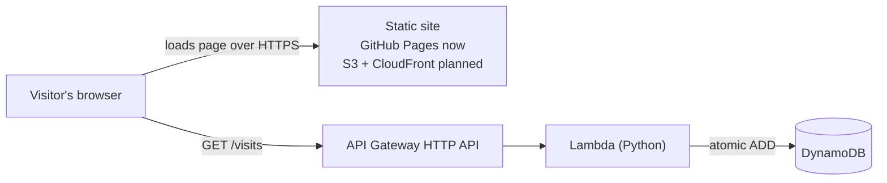

# Cloud Resume: Frontend

My resume website, built for the [Cloud Resume Challenge](https://cloudresumechallenge.dev/) on AWS. It is plain HTML, CSS and vanilla JavaScript (no frameworks, no build step) and shows a live visitor counter backed by a serverless API.

**Live site:** https://jasonazier21.github.io/resume-frontend/
*(Temporary hosting on GitHub Pages while AWS reviews my new account for CloudFront access. The planned production setup is a private S3 bucket behind CloudFront.)*

**Backend repo:** https://github.com/jasonazier21/resume-backend

## Architecture



1. The browser loads the static page.
2. `script.js` calls `GET /visits` on an API Gateway HTTP API.
3. A Python Lambda atomically increments a counter item in DynamoDB and returns `{"count": N}`.
4. The page shows the number in the footer.

## What's in this repo

| File | Purpose |
|------|---------|
| `index.html` | Page structure and content |
| `style.css` | Responsive layout, dark/light theme, print styles |
| `script.js` | Theme toggle and the visitor-counter call (`API_URL`) |
| `favicon.svg` | Site icon |
| `deploy.ps1` | Syncs the site to an S3 bucket and invalidates CloudFront |

## Security and design notes

- **Least privilege:** the Lambda's IAM role is allowed one action (`dynamodb:UpdateItem`) on one table.
- **Atomic counter:** the Lambda uses a DynamoDB `ADD` update, so simultaneous visitors cannot overwrite each other's count.
- **No credentials in code:** the CLI uses short-lived `aws login` credentials and there are no access keys.
- **CORS** is currently open (`*`) because the endpoint is a public, read-only counter. It will be restricted to the site's domain once hosting is final.
- The S3 bucket for the final setup is private (Block Public Access on) and will be served through CloudFront with origin access control.

## What I learned

- A first Lambda invocation (cold start) took about 3.7 s and timed out at the 3 s default. I raised the timeout to 10 s and memory to 256 MB.
- CORS must be enabled on the API, and pages opened from disk (`file://`) send `Origin: null`, so I tested through a local web server instead.
- `count` is a DynamoDB reserved word, so the update expression uses an attribute-name placeholder.
- New AWS accounts can be blocked from creating CloudFront distributions until they build usage history, so I host the front end on GitHub Pages in the meantime.

## Roadmap

- [x] Static resume site
- [x] Serverless visitor counter (Lambda, API Gateway, DynamoDB) with unit tests
- [x] Live HTTPS hosting (GitHub Pages, temporary)
- [ ] S3 + CloudFront with HTTPS (waiting on AWS account review)
- [ ] Rebuild all infrastructure in Terraform
- [ ] GitHub Actions deployment using OIDC (no stored keys)

## Run locally

```powershell
python -m http.server 8000
# open http://localhost:8000
```

## Deploy to S3 (once CloudFront is available)

```powershell
.\deploy.ps1 -Bucket YOUR_BUCKET -DistributionId YOUR_DISTRIBUTION_ID
```
